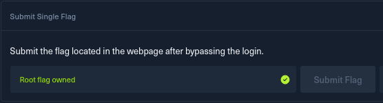

# Appointment — HTB Starting Point

**Difficulty:** Very Easy
**OS:** Linux
**Tags:** web, SQL injection, authentication bypass

## Overview

Appointment is a machine within the Starting Point track of Hack The Box. The machine is running a web login page. It is vulnerable to an SQL injection, which I used to bypass the password authentication and log in to the admin account.

## Enumeration

I started with an nmap service scan to see what was running on the target:

```
nmap -sV <target-ip>
```

It found a singular port open which was port 80. Port 80 was running the service Apache httpd at version 2.4.38 (Debian)

Opening `http://<target-ip>` in the browser showed a login page.


## Exploitation

The box guided me to a SQL injection, but even without the guide it would be safe to assume the input on a login form goes to a database query. On a login form you can then try SQL injection.

A common test is to enter a single quote (') in a field. If the login page gives an error message or the page behaves unexpectedly, you have validated that the input is vulnerable to injection. 

In the **username** field I entered the following payload, and anything in the
password field:

```
admin'#
```


This logged me in as admin without knowing the password, and the page returned
the flag.

## Why it works

The application almost certainly builds a query like this:

```sql
SELECT * FROM users WHERE username = 'INPUT' AND password = 'INPUT';
```

My input `admin'#` changes it to:

```sql
SELECT * FROM users WHERE username = 'admin'#' AND password = '...';
```

- The `'` closes the username string early.
- The `#` comments out the rest of the line in MySQL, so the entire
  `AND password = '...'` check is ignored.

The database just looks for the user `admin` and logs me in — the password is
never checked.

## The flag

After I successfully logged in to the login page using an SQL injection, I retrieved the flag and submitted it to complete the box




## Remediation

This vulnerability exists because user input is concatenated directly into the SQL
query as code. The fix:

- **Use parameterised queries / prepared statements** so user input is always
  treated as data, never executed as part of the SQL.
- Validate and sanitise input as defence in depth.
- Run the database account with least privilege.

## Lessons learned

The biggest lesson I learned from this box was the way the SQL injection actually works, instead of the fact that it just works - specifically the way the input gets processed into the query itself and how to test for injection possibilities. 


---

*Classification: OWASP Top 10 (2021) — A03:2021 Injection*
